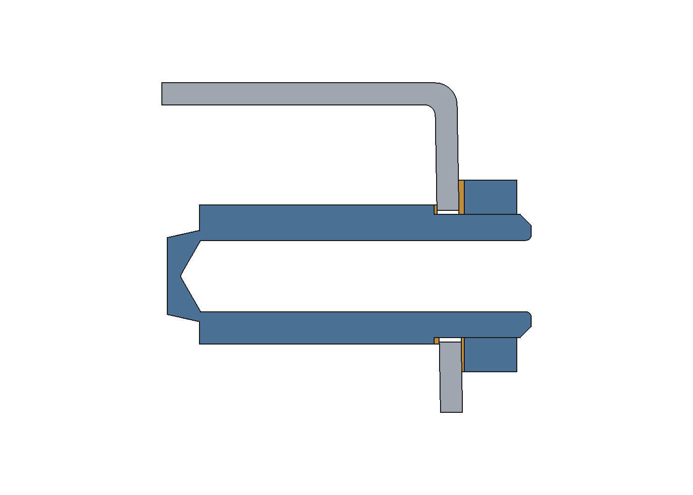
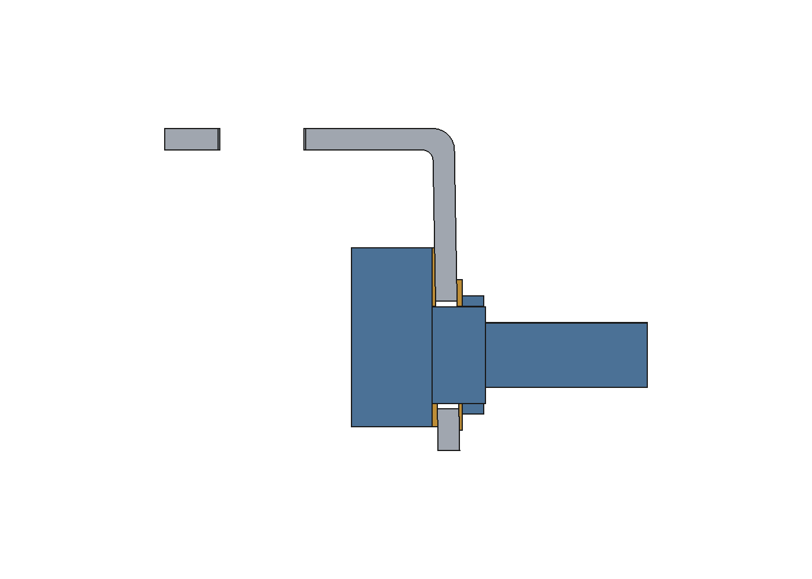

# Issue 14 — studio aggiornato con aperture posteriori chiuse

18 ottobre 2026. PR #18, stesso branch e unico [assembly.FCStd](assembly.FCStd).

**Il percorso completo d'inserimento non è ancora verificato. Le asole aperte
fino al fondo sono state respinte dall'utente e rimosse dal CAD, dagli script
e dalle viste consegnate. Non costituiscono una soluzione proposta.**

Sono implementati una correzione della simulazione, una sagoma PCB candidata,
gli ingombri significativi disponibili e una nuova soluzione nominale di
appoggio posteriore con compensatori anulari. Il lavoro risolve il precedente
deficit assiale MASTER nel modello nominale, ma non soddisfa ancora tutti i
criteri di accettazione del montaggio. Nessuna foratura o lavorazione autorizzata.

## A. Risultato consigliato e limiti

Conservare i fori chiusi e i componenti acquistati. La proposta utile da esaminare
è il serraggio con compensatori interni/esterni a 1°: il compensatore esterno
MASTER **sostituisce** la rondella piana, anziché aggiungersi al vecchio stack.
L'arretramento dei due componenti è 0,180205 mm; le sei spalle pot e la PCB
rimangono alle quote acquisite. I compensatori sono componenti custom da
approvare, non accessori commerciali già selezionati.

Non consiglio di forare o trasferire questa sagoma a KiCad: manca il percorso
completo. Non ho dimostrato l'impossibilità di ogni moto 6DOF e non la deduco
dall'esito negativo delle ricerche locali. Non presento alternative non verificate
come soluzioni realizzabili.

## B. Modifiche prima/dopo

| Elemento | Baseline | Studio attuale | Stato |
|---|---|---|---|
| Sei fori pot | Ø10 | Ø10, centri invariati | Conservati |
| Encoder | Ø7,2 | Ø7,2 | Conservato |
| Jack / MASTER | Ø12 / Ø10 chiusi | Ø12 / Ø10 chiusi | Conservati; nessuna asola |
| USB | 8,94×3,45 | Invariata nel CAD attivo | Gioco funzionale ancora da assegnare |
| Spalle jack e MASTER Y | 58 | 57,819795 | Proposta CAD, non KiCad |
| Spalle pot / F.Cu / B.Cu | 31,8 / 24,3 / 22,7 | Invariate | Battuta pot conservata |
| Compensatori | Esempio min0,5 non implementato | Anulari min0,25 implementati | Parametro progettuale da approvare |
| MASTER esterno | Dado2 + rondella0,5 + compensatore | Dado2 sul compensatore-rondella | Recupera0,5 mm; residuo nominale0,203 |
| Encoder interno | Vuoto1 mm | Anello Ø12/Ø7,2 ×1 | Appoggio CAD, non distanziale pot |
| PCB | Solo piano | Ottagono 1,6 mm | Sagoma candidata senza forature |

Vertici PCB XY in mm: (−38;−56), (38;−56), (43;−50), (43;50), (38;56),
(−38;56), (−43;50), (−43;−50). Ingombro massimo86×112, non rettangolare.
Nessuna modifica di sagoma/placement è stata trasferita al progetto KiCad.

Per USB il disegno GCT RevB conservato quota8,94 con tolleranza generale X.XX
±0,20: **9,14 mm è soltanto il limite per la larghezza massima del componente**.
La larghezza produttiva deve soddisfare
`W ≥ 9,14 + 2(gioco funzionale + errore placement + errore taglio)`.
I termini mancanti non sono stati inventati. Non è quindi dichiarato un minimo
comprensivo di un gioco di montaggio che non è ancora definito. Gli aumenti
USB usati nella ricerca sono sonde diagnostiche, non nuove quote da forare.

## C. Simulazione corretta e prova disponibile

La funzione esistente `search_engaged_phase` ora include boccole **e alberi
finiti**, verifica anche i cerchi terminali e attiva i vincoli delle generatrici
soltanto lungo il segmento fisico. Un valore negativo di
`generator_phase_min_mm` non respinge più automaticamente una posa. Restano
variabili tutte e tre le traslazioni, pitch, roll e yaw.

Il candidato a pitch1°, traslazione(−0,276246;+0,113847;−0,196604) mm,
roll−0,047836°, yaw+0,350408°, con sonda USB9,54×4,05, non mostra collisioni
nei solidi controllati nella **singola posa**. Non prova un percorso continuo.

A pitch2°, traslazione(−0,081617;+0,206327;+0,341818), roll−0,619436°,
yaw+0,359821°, il controllo OCC trova:

| Oggetti contro scocca forata | Intersezione mm³ |
|---|---:|
| Jack NRJ4HF | 5,083347 |
| Boccola encoder | 1,814715 |
| Corpo pot3 (inviluppo conservativo) | 2,711960 |
| Boccola pot1 / pot2 | 1,450201 / 0,006233 |
| Boccola pot4 / pot5 | 2,081650 / 0,174748 |

Le forme comuni sono valide; gli operandi invertiti riproducono i volumi.
L'allargamento USB da solo non risolve **questo candidato**. Non è una prova
di impossibilità generale e non giustifica allargare i fori frontali alla cieca.

È stata eseguita anche una ricerca diagnostica limitata con potØ13, encoderØ11,
jackØ16,45, MASTERØ13, USB libera di5 mm per lato, traslazioni±15 mm e
roll/yaw±5°. Sono dimensioni di screening, **mai applicate al CAD**. Emerge
un candidato locale a4°; da8° il margine necessario ottimizzato è negativo
(−0,538 mm). Nessun percorso completo trovato; ricerca fermata senza proseguire
indefinitamente. I risultati grezzi restano nel JSON con i limiti espliciti.

La sequenza iniziale → impegno posteriore → raddrizzamento → battuta non viene
illustrata come riuscita: mancherebbe la verifica delle transizioni richiesta.
L'immagine storica d'inserimento resta una diagnostica precedente, non una prova
corrente. Le nuove viste mostrano esclusivamente la posa finale e il serraggio.

### Sagoma e copertura dei solidi

Aggiunti PCB candidata, inviluppi CHERRY15,63×15,63×18,5 (3,3 sotto PCB dal
layout MX, 15,2 sopra), ESP32-1U con massimi18,4×19,6×3,35 e XY U1 restituiti
da Konnect, e riserva DAC30,48×20,32 a Z10…22,7. Quest'ultima è uno spazio
progettuale, **non lo spessore fisico del breakout**. I dati sono dai documenti
conservati; non sono stati inventati modelli dettagliati mancanti.

Restano esclusi stack fisico display/DAC, fissaggi DAC, clip/terminali pot ed
encoder non rappresentati, eccedenze di saldatura, cavo antenna, RESET/BOOT e
altri gruppi non registrati. I loro placement PCB esistenti non sono automaticamente
compatibili con la nuova sagoma. Il blocco completamente popolato resta NON VALIDATO.

Nella posa finale i 36 solidi inclusi sono validi e non intersecano la scocca
con aperture chiuse. Questo controllo statico non certifica il movimento.

## D. Serraggio e copertura

| Quota nominale mm | Jack | MASTER |
|---|---:|---:|
| Compensatore interno min…max | 0,250…0,471679 | 0,250…0,541500 |
| Compensatore esterno min…max | 0,250…0,554591 | 0,250…0,494371 |
| Piano appoggio dado Y | 60,585853 | 60,616835 |
| Naso/boccola oltre appoggio | 6,083942 | 2,202959 |
| Dado: ingombro assiale | 4,75 | 2,00 |
| Residuo oltre dado | 1,333942 | **0,202959** |

Il residuo jack è riferito alla punta del naso, non alla filettatura utile.
Il minimo0,25 è un parametro progettuale: non è una prestazione certificata
del materiale. Il deficit MASTER precedente è eliminato nominalmente usando
il dado M9×0,75 SW11×2 del riferimento reale Alps RKZ00023UA senza la sua
rondella piana; l'anello inclinato esterno svolge la funzione di rondella.
Tolleranze, materiale, coppia e resistenza restano da verificare.

Il carico nominale segue corpo → compensatore interno → scocca → compensatore
esterno → dado. Non si usa il dado per tirare la PCB fuori dalla battuta dei pot.
Il contatto piano del dado è rappresentato nelle sezioni native modificabili.
Il controllo OCC dei quattro compensatori contro la scocca e dei due dadi
contro i compensatori esterni restituisce volume comune nullo e distanza
inferiore a 0,000001 mm: contatto nominale senza compenetrazione.




| Gruppo | Copertura estetica | Appoggio nominale | Fissaggio definitivo |
|---|---|---|---|
| Pot + Davies1100 | PASS in proiezione, baseline conservata | PASS dimensionale con rondellaØ14/Ø9,1×0,5 e dadoSW11×2; residuo0,5 | NON VALIDATO: accessorio da approvare, tolleranze/coppia e incavo manopola |
| Jack + NRJ-NUT-B | PASS in proiezione sul foroØ12 | PASS geometrico con compensatori | NON VALIDATO: filetto utile e resistenza degli appoggi |
| MASTER + CliffK85M | PASS in proiezione; posizione assiale NON VALIDATA | PASS dimensionale con compensatore-rondella e dado2; residuo0,203 | NON VALIDATO: incavoCliffØ12 contro diagonaleSW11≈12,70, piatto4,5/5AF e tolleranze |
| Encoder + SAK023 | PASS in proiezione; gonna ancora9,9 sopra pannello | PASS nominale con appoggio interno1; ferramenta PEC11R e residuo1,5 | NON VALIDATO: accoppiamento, tolleranze; quota estetica rialzata da accettare |

Per encoder è implementato soltanto l'appoggio interno1 mm, mantenendo albero
e manopola acquistati integri. Questo impedisce il recupero forzato del vuoto,
**non abbassa la gonna SAK**. Le due quote fisiche display restano sconosciute.

## E. Stato della consegna e decisioni

Non è disponibile una soluzione d'inserimento verificata che soddisfi tutti i
vincoli attuali. Non chiedo di approvare lavorazioni sulla base di questo risultato.
La proposta anelli/sagoma è esaminabile, ma non va trasferita a produzione o KiCad.
L'altezza SAK9,9 richiede una scelta estetica; per chiudere il display rimangono
necessari spessore fisico PCB e distanza PCB-vetro.

Riproduzione nella console FreeCAD, assieme aperto:

```python
from pathlib import Path
p = Path(App.ActiveDocument.FileName).with_name('issue14-mechanical-check.py')
exec(compile(p.read_text(encoding='utf-8'), str(p), 'exec'))
s = search_engaged_phase(App.ActiveDocument, usb_margin=0.3, angles=[0,1,2,4,6,8,12,16])
r = local_pose_check(App.ActiveDocument, s, angle=2)
```

La ricerca locale dura circa15 secondi sulla macchina di lavoro. Non è un test
pass/fail del montaggio completo. `solution_study` rigenera i solidi della proposta
nel solo assieme e modifica il documento. Nel JSON, lo studio precedente è
conservato in `historical_baseline.before_closed_aperture_study`.
Nessun merge, chiusura issue14, nuova PR, routing, firmware, KiCad o STL.


La baseline del commit8dc4981 è conservata nel JSON e nello storico Git; non è stata rieseguita.
