# Issue 14 — inserimento geometrico

**NON ANCORA DIMOSTRATO per il gruppo completo.** PCB candidata e potenziometri passano verticalmente dal fondo. I connettori posteriori impediscono quella sequenza; la manovra inclinata incontra anche boccole posteriori ed encoder. Non è una dimostrazione di impossibilità di altre manovre. PR #18, 18 ottobre 2026; dati di partenza e8e5a74.

## Configurazione

Nell'unico [assembly.FCStd](assembly.FCStd), jack e MASTER sono ripristinati alle posizioni nominali precedenti alla compensazione. Il gruppo **ManualInsertion** contiene composti FreeCAD nativi collegati alle sorgenti, con un'unica trasformazione rigida per posa. **InsertionGeometry** contiene le sezioni. Dadi, manopole, compensatori e appoggio custom encoder sono esclusi dall'inserimento. **OptionalCompensation**, nascosto, conserva componenti compensati e ferramenta; le vecchie sezioni sono nascoste. Scocca originale intatta.

Gruppo completo: **33 oggetti rappresentati**. Sottogruppo: 28, escludendo jack, USB e i tre oggetti MASTER. Il DAC è soltanto una riserva volumetrica. Restano mancanti spessore PCB e distanza PCB-vetro del display 5393, stack/fissaggio reale DAC, terminali/clip non rappresentati, saldature, cavo antenna e altri ingombri già esclusi. Il montaggio completamente popolato non è validato.

## Geometria prima del movimento

| Misura nominale | Risultato |
|---|---|
| PCB 86 × 112 × 1,6, angoli smussati | Passa verticalmente; distanza minima **0,2506 mm** dalle quattro zone delle colonne, vicino a X±40,204 / Y±53,355 / Z24,3 |
| Apertura inferiore a Z4 | Ingombro libero centrale 91,492 × 116,792; colonne/nervature restringono gli angoli, quindi non è un rettangolo completamente libero |
| Arretramento Y della PCB in posa finale | −0,39 mm senza intersezione; −0,40 introduce un piccolo contatto agli angoli. Limite relativo a questa posa |
| Pot: corpo / boccola / albero | Corpo Z24,3…31,8; Ø9 Z31,8…36,8; Ø6 Z36,8…51,8; foro Ø10; pannello Z31,8…33,8 |
| Disimpegno verticale pot | Boccole completamente sotto il pannello oltre 5 mm; alberi oltre 20 mm |
| Gioco radiale pot | Boccola **0,5 mm**, albero **2 mm**; cilindri limitati alle lunghezze fisiche |
| Inclinazione locale nel solo foro pot | Asse centrabile in un pannello da 2 mm: circa 16,74° per Ø9, 42,65° per Ø6, dalla relazione r/cos(a) + tan(a) ≤ 5. Non sono angoli consentiti all'intero assieme |
| Arretramento orizzontale per liberare la parete interna | Jack circa **8,76 mm**, punta MASTER **19,81 mm**, inviluppo bocca USB circa **1,93 mm**. Corse complete di disimpegno, non giochi dei fori |

Le corse posteriori usano la parete interna già nota Y + tan(1°) Z = 58,4660. Nessun nuovo studio di appoggio sulla parete inclinata.

| XY: PCB blu e ostacoli sotto Z24,3 | Y-Z: pot a X0 |
|---|---|
| 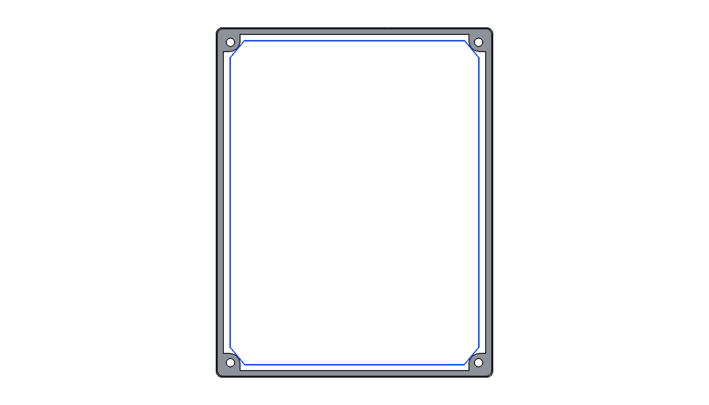 | 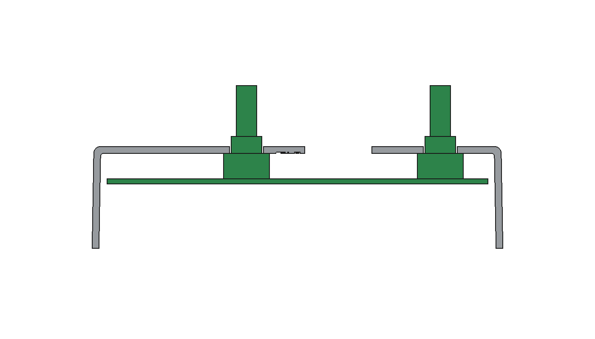 |

| Y-Z jack, X12,5 | Y-Z MASTER, X−31 | Y-Z USB, X−17,5 |
|---|---|---|
| 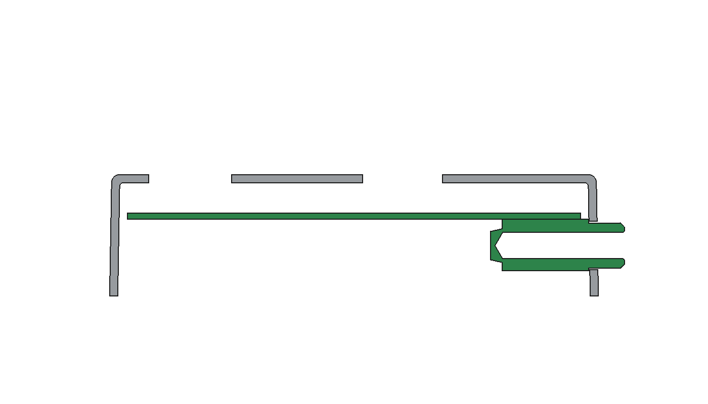 | 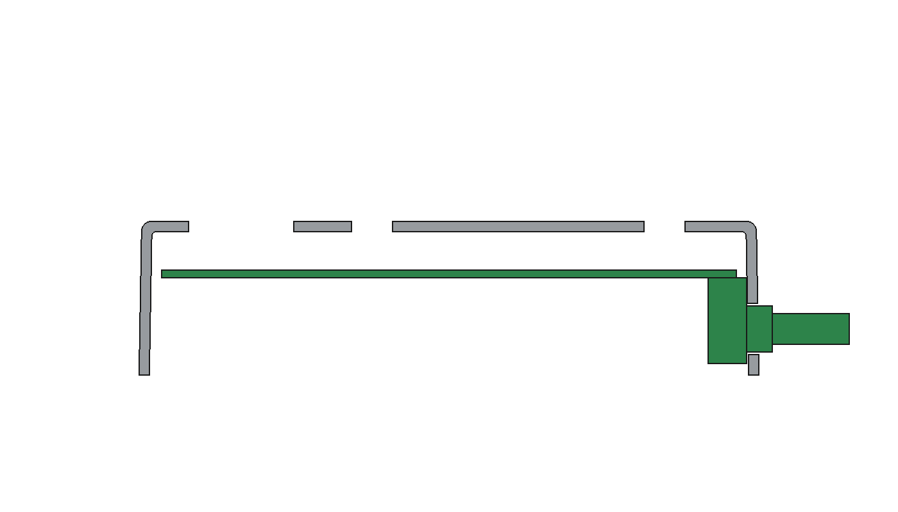 | 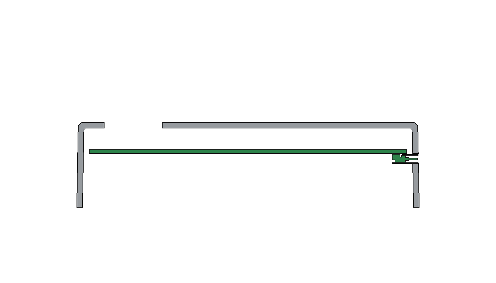 |

## Cinque pose: percorso verificato SOLO senza connettori posteriori

Tenere il sottogruppo orizzontale, centrare gli angoli smussati tra le colonne e sollevare verticalmente. **Queste viste non sono istruzioni valide per montare la PCB completamente popolata.** La mezza scocca è una sezione visiva; le collisioni sono controllate sulla scocca intera.

| Posa rispetto alla battuta | Vista |
|---|---|
| 1 — ingresso dal fondo, ΔZ −55 mm | 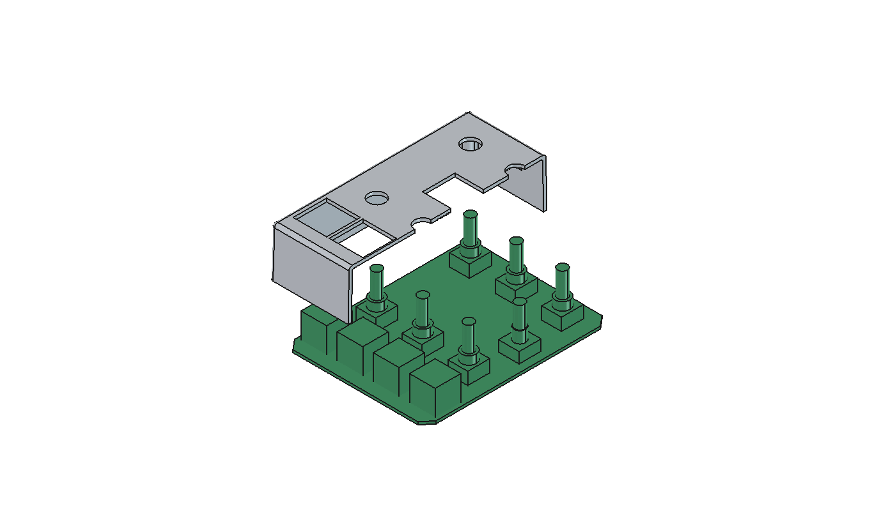 |
| 2 — punte appena sotto il pannello, ΔZ −20,1 mm | 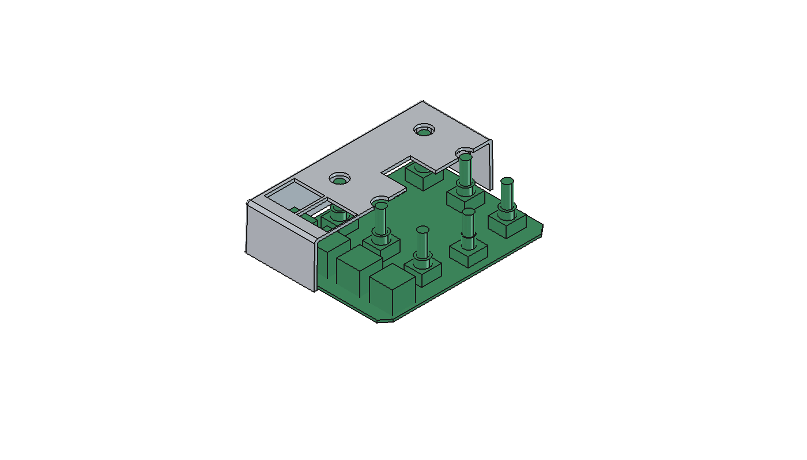 |
| 3 — alberi impegnati, boccole ancora sotto, ΔZ −5,1 mm | 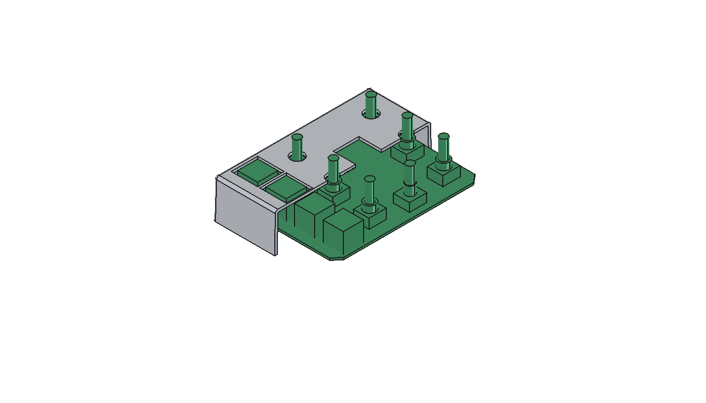 |
| 4 — boccole impegnate, ΔZ −2 mm | 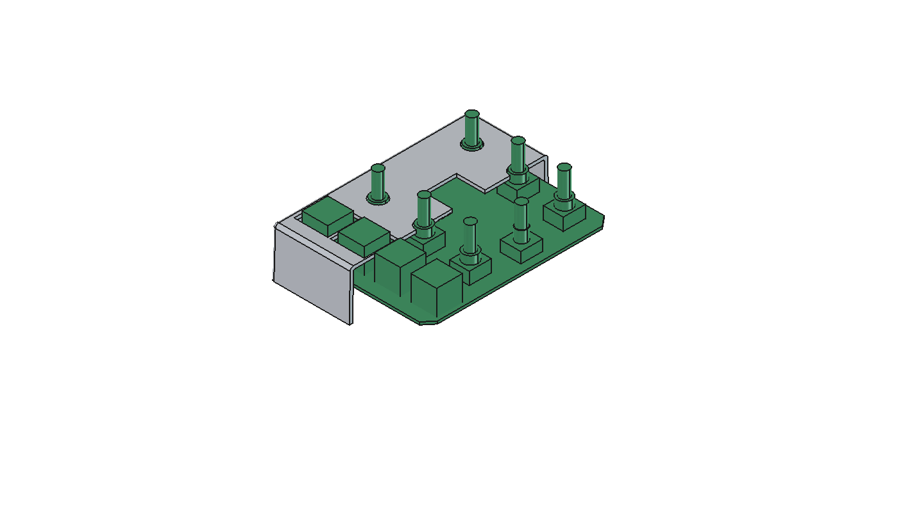 |
| 5 — battuta dei sei pot, ΔZ 0 | 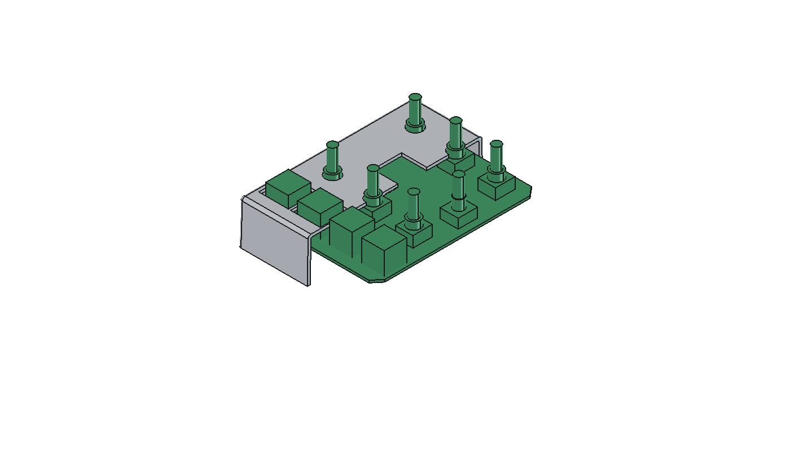 |

**Tutti gli spostamenti intermedi sono verificati:** i volumi spazzati lungo i 55 mm sono prismi e cilindri allungati, confrontati con la scocca in OCC. Nessuna intersezione volumetrica per i 28 oggetti. Non dipende da pose isolate o dal passo di campionamento. Distanze minime: PCB 0,2506; boccole pot 0,5; alberi pot 2; encoder 0,1; CHERRY 2,385 mm. Contatto finale delle spalle intenzionale. Angolo minimo del sottogruppo: **0°**.

## Gruppo completo: interferenze e disimpegno

La rotazione di prova usa l'asse X e il riferimento Y59,1834 / Z16,2, vicino all'asse jack. È una scelta per contenere lo spostamento del jack in questo tentativo, **non un perno fisico imposto**. Provati anche abbassamento puro, arretramento puro e inclinazione opposta con abbassamento. Nessuna ricerca 6DOF o flessione PCB.

| Fase / posa | Misura in mm | Interpretazione / correzione locale |
|---|---|---|
| A — battuta, 0° | Nessuna intersezione dei 33 oggetti; USB senza gioco funzionale | Posa statica, non prova d'inserimento |
| B — abbassa 0,4 | USB: penetrazione inferiore **0,40** | Occorrerebbe almeno 0,40 in basso per questa sola posa |
| B — abbassa 0,5 | Jack: circa **0,10** oltre il gioco radiale; USB **0,50** | Il contatto jack è modesto; correggerlo non libera le boccole pot |
| B — inclina +1° | Encoder: penetrazione radiale **0,215**; USB circa **0,018** | Recuperi locali possibili, insufficienti a completare il movimento |
| C — +2° | Boccole pot: **0,128** fila Y42, **0,163** fila Y−15; encoder **0,545** | I pot richiederebbero pochi decimi, l'encoder è già un ostacolo maggiore |
| C — +4° | Corpi jack / MASTER contro parete: **0,143 / 0,352** nella normale | Arretrare entrambi di 0,5 elimina questi due contatti nella posa; restano pot ed encoder |
| C — +4,1° | Boccole Y−15 libere: Zmax **31,765**; solo alberi nei loro fori | La differenza Ø6/Ø9 è effettivamente sfruttata |
| C — +4,1° | Boccole Y42: penetrazione radiale **0,817**; encoder **1,292**; boccole posteriori Zmax **35,840** | Sequenza bloccata. Richiederebbe localmente almeno Ø11,635 e Ø9,784: **non applicati né proposti come soluzione** |
| Alternativa: arretra 0,5 a 0° | Encoder **0,40** radiale; primi contatti PCB/colonne | Recuperare pochi centesimi sulla PCB non fornisce le corse posteriori di 8,76 / 19,81 mm |
| Alternativa: arretra 2 a 0° | Pot **1,50**, encoder **1,90**, PCB contro colonne | Non risolve il disimpegno posteriore |
| Alternativa: −1°, abbassamento 1,1 rispetto al riferimento pot | Jack, USB e MASTER interferiscono; spigoli dei corpi pot anteriori circa **0,012** sopra battuta | Il contatto minimo dei pot non è il motivo di arresto; persistono i posteriori |
| D — uscita dal fondo del gruppo completo | Nessun collegamento verificato dalla posa C all'uscita | Angolo minimo per il gruppo completo **non determinato** |

Penetrazioni radiali ricavate dalle sezioni finite nel pannello con discretizzazione locale OCC; i millesimi servono al confronto, non definiscono tolleranze produttive. Boccole e corpi metallici/plastici sono trattati rigidi; scocca plastica e PCB non sono deformate. Nessun esito è basato sul solo volume comune. I centesimi sono segnalati, non usati automaticamente per fermare lo studio. Nessun carico su saldature è giustificato.

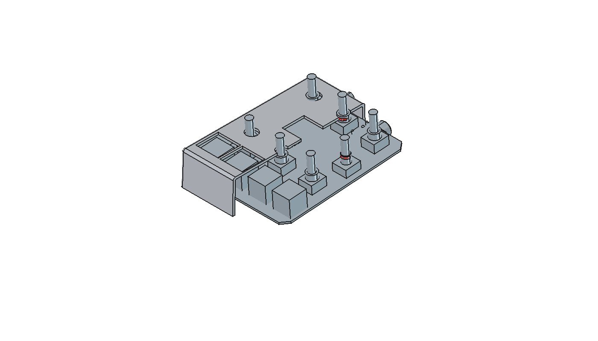

## Quote effettivamente cambiate

| Quota | Studio compensato precedente | Inserimento nominale attivo |
|---|---:|---:|
| Spalla jack Y | 57,819795 | **58,000000** |
| Spalla MASTER Y, corpo/boccola/albero solidali | 57,819795 | **58,000000** |

Nessun foro o contorno PCB cambiato. L'arretramento diagnostico di 0,5 mm non è applicato; compatibilità con pad/fissaggio non validata. Non risolvendo il percorso, non giustifica una modifica al layout. Nessuna nuova apertura richiede una nuova verifica di copertura della ferramenta/manopole.

## Verifica e limiti

Dati in **nrj4hf-validation.json** e nell'oggetto **InsertionGeometryResults**. Le pose inclinate usano trasformazioni incorporate nelle forme: OCC aveva restituito un falso zero sulla boccola encoder a 4,1° usando solo Placement; il controllo incorporato trova 16,475 mm³. L'ulteriore campionamento diagnostico inclinato, interrotto da un blocco OCC, **non è usato come prova**. La prova continua del sottogruppo era già conclusa e ne è indipendente.

Per riprodurre soltanto la prova continua, caricare issue14-mechanical-check.py nella console FreeCAD, chiamare **vertical_insertion_sweep(App.ActiveDocument)** e verificare che ogni common_mm3 sia inferiore a 1e-6. Nessuna vecchia ricerca da rilanciare.

Assieme salvato e riaperto; geometrie e collegamenti verificati. Nessun merge, modifica KiCad, routing, firmware o lavorazione. **Verificare queste viste prima di qualunque trasferimento a KiCad; il percorso del gruppo completo resta da dimostrare.**
