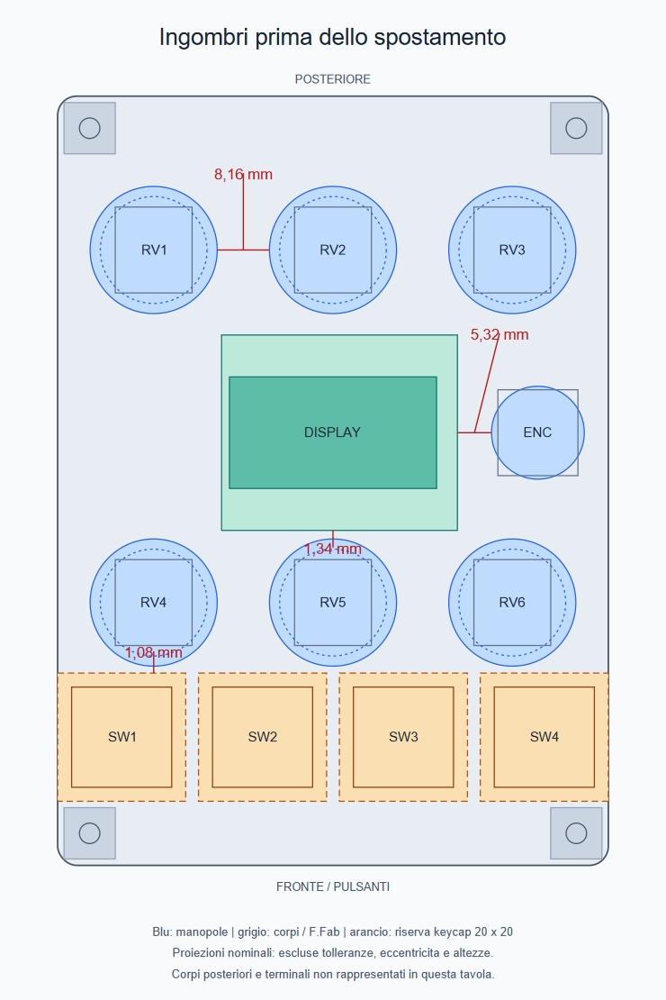

# Issue #35 — verifica di manopole, scocche e accessibilità

Verifica del 30 ottobre 2026; stato iniziale al commit `e867ae9`, 86 × 120 mm.
Segue aggiornamento autorizzato a 86 × 126 mm.
**Aggiornamento applicato dopo la revisione:** l'utente ha autorizzato la
lunghezza 126 mm e lo spostamento dei comandi verso il retro. Pulsanti e fori
anteriori restano fermi; RV4–RV6 e R11–R13 salgono di 3 mm; gli altri componenti
e i due fori posteriori salgono di 6 mm. Bordo superiore Y=−6, inferiore Y=120.
Tutte le modifiche KiCad sono avvenute tramite Konnect MCP.

| Margine nominale | Prima, 120 mm | Dopo, 126 mm |
|---|---:|---:|
| Manopole inferiori–riserva keycap | 1,08 mm | **4,08 mm** |
| Display–manopola centrale inferiore | 1,34 mm | **4,34 mm** |
| Gonne dei potenziometri adiacenti | 8,16 mm | 8,16 mm |
| Encoder–display | 5,32 mm | 5,32 mm |

Il [layout aggiornato](issue-35-standalone-layout.md) e la
[vista frontale aggiornata](layout-35/F-layout.png) mostrano il risultato.
Verificate 68 posizioni, 237 connessioni pin–rete invariate e nessuna intrusione
dei pad nelle riserve M3. Il DRC finale ha zero errori geometrici; restano
115 warning geometrici, 160 connessioni non instradate e 68 segnalazioni di parità.
Gli accoppiamenti delle manopole, il keycap effettivo, il fissaggio display e la
prova ergonomica fisica restano **da qualificare**. Nessun routing aggiunto.

## Evidenze della revisione iniziale, prima dello spostamento

Le quote e la tavola seguenti descrivono il PCB **86 × 120 mm precedente**;
i due passaggi stretti sono stati aumentati come indicato sopra. Le osservazioni
su componenti, tolleranze e accoppiamenti restano applicabili.

## Metodo e limiti

Konnect MCP ha letto il PCB salvato e riesportato GenCAD e F.Fab/B.Fab.
KiCad non era aperto: non esiste uno stato live verificato in questa sessione.
Le misure courtyard provengono da `check_clearance`, modalità `courtyard`,
con sorgente `saved_file`. I dati e l'hash del PCB sono nei
[risultati numerici](mechanical-review-35/measurements.json).
Sono stati confrontati i componenti effettivi di [BOM](BOM.csv) e
[registro acquisti](acquisti.csv) con i disegni dei produttori.

Un courtyard libero non verifica la manopola, le dita, le altezze o i cavi.
Le distanze sotto sono proiezioni XY nominali; non includono tolleranze di
montaggio, eccentricità, inclinazione degli alberi o flessione della scheda.
Il keycap 20 × 20 mm è una riserva progettuale: non è un componente identificato.
Il disegno riassuntivo mostra i comandi frontali, non tutti i terminali e i corpi posteriori.

## Distanze e giudizio

| Coppia / zona | Misura nominale | Valutazione |
|---|---:|---|
| Davies adiacenti, passo 28 | 8,16 mm fra gonne; 11,33 mm fra corpi di presa | Nessuna interferenza nominale. Disposizione compatta, plausibile per la regolazione singola; uso simultaneo con due mani da provare. Non serve allargare la scheda per una collisione qui. |
| Scocche potenziometri adiacenti | 16 mm fra i contorni F.Fab larghi 12; 11,40 mm fra courtyard comprendenti terminali/fissaggi | Spazio sufficiente nel piano. La scocca non è l'elemento che limita il passo: lo sono le manopole. |
| RV4/RV6–keycap esterni | **1,08 mm** fra gonna e riserva 20 × 20 | Punto più critico per l'uso. Rischio di toccare la manopola premendo il tasto o il tasto ruotando la manopola. Il dislivello può aiutare, ma non è qualificato. |
| RV5–keycap centrali | circa 1,12 mm, per lo sfalsamento X | Stesso rischio della coppia precedente. La riserva non comprende un keycap reale, la sua inclinazione o gioco laterale. |
| RV5–bordo inferiore PCB display | **1,34 mm** dalla gonna | Margine ridotto vicino a un elemento fragile. Non è una collisione dimostrata: il risultato 3D dipende da altezza del modulo e inserimento manopola. Non lo considero già approvato ergonomicamente. |
| RV2–bordo superiore display | 0,31 mm **fra courtyard**, 6,56 mm fra contorno F.Fab del corpo e PCB breakout | Il valore 0,31 riguarda le riserve dei terminali, non scocche che quasi si toccano. Poco margine per lavorazione/montaggio; evitare di spostare semplicemente il display verso RV2 per liberare RV5. |
| Encoder–display | 5,32 mm dalla gonna SAK; 6,32 mm dalla scocca larga 12,5 | Nessuna interferenza nominale. Accesso migliore dal bordo destro, che dista 3,75 mm dalla gonna. Presa sul lato verso display più limitata; corsa click da verificare in altezza. |
| Encoder–pot superiore/inferiore destro | 7,55 / 10,30 mm fra courtyard | Nessuna interferenza nominale dei corpi e terminali. |
| CHERRY adiacenti | 6,37 mm fra corpi da 15,63 mm | Nessuna collisione dei corpi. |
| Keycap adiacenti | 2 mm con riserve da 20 mm | Dipende dal cappuccio effettivo. A piena corsa di 4 mm e con gioco laterale deve rimanere libero. |
| Keycap esterni–bordi e viti | Arrivano a X=0/86; 1 mm dalla riserva quadrata M3 anteriore | Nessun margine laterale per cappucci più grandi o disassati. La ferramenta effettiva va verificata lungo tutta la corsa. |
| MASTER–USB / MASTER–DAC | 15,10 / 23,79 mm fra courtyard posteriori | Corpi separati. Queste misure non includono manopola MASTER, dita o guscio del cavo USB. |
| DAC–ESP32 | 9,59 mm fra courtyard | Nessuna interferenza nominale dei due moduli nel piano. Header, saldature e cavo antenna restano controlli in altezza. |

Il limite ergonomico è soprattutto **longitudinale**, fra display, fila inferiore
dei potenziometri e tasti, non il passo orizzontale dei sei potenziometri.

## Accoppiamento delle manopole: non basta la dicitura «6 mm»

### Davies 1100 sui sei PTV111-3420A-B203

Il [catalogo Davies, pagina stampata 24](../cad/sources/Davies-Catalog-Instrument-Knobs.pdf)
specifica inserto in ottone da 1/4″ con grano: foro nominale **6,35 mm**.
La gonna è 25/32″ = 19,84375 mm, il corpo di presa 21/32″ = 16,66875 mm.
Il [disegno Bourns, pagina 2](../cad/sources/Bourns-PTV-PTT.pdf) quota l'albero
plastico D a **6,0 +0/−0,5 mm**, con quota del piatto 4,5 +0/−0,5 mm.

Il gioco diametrale nominale è quindi 0,35 mm e può raggiungere 0,85 mm
considerando il solo intervallo Bourns. Il grano può permettere il serraggio;
non si può però affermare che la manopola risulti concentrica o che la presa
sull'albero plastico sia adeguata. Le distanze della tabella presuppongono
manopole concentriche: **non assorbono l'eccentricità di questo accoppiamento**.
Provare tenuta, rotazione completa e oscillazione senza serrare eccessivamente.

### Same Sky SAK-023 sul PEC11R-4120F-S0018

Il [disegno SAK-023](../cad/sources/SameSky-SAK-023.pdf), pagina 1, indica un
albero compatibile Ø**5,96–5,98 mm** e quota sul piatto **4,46–4,48 mm**.
Il [PEC11R](../cad/sources/PEC11R.pdf), pagine 2–3, ammette invece
Ø**6,0 ±0,1 mm** e piatto **4,5 +0/−0,05 mm**.
Gli intervalli non garantiscono l'accoppiamento per tutti i pezzi conformi:
può funzionare sul campione, ma non è qualificato dalla sola dicitura «6 mm D».

La SAK ha gonna Ø14,5 ±0,1 mm. Il PEC ha corsa click 0,5 ±0,3 mm:
verificare almeno **0,8 mm di corsa disponibile**, oltre al margine di montaggio,
senza che il coprimanopola tocchi ghiera, dado o altra superficie fissa.
La SAK dichiara forza di inserimento/estrazione 1,5–7 kgf, circa 15–69 N:
montarla sostenendo il componente, evitando di scaricare la forza sulla PCB
appoggiata soltanto ai quattro angoli. Questo valore non è la forza del click.

### Cliff K85M / CL170805B sul MASTER PTV111-1420A-B103

Il [disegno Cliff](../cad/sources/Cliff-K85M.pdf) quota la sede D Ø6 e
**5 mm A/F**; il PTV111-1 ha piatto **4,5 +0/−0,5 mm**.
È una differenza di profilo documentata, non una compatibilità dimostrata.
La scheda Cliff non fornisce qui una tolleranza o una dichiarazione di compatibilità
con quel Bourns: verificare gioco angolare, tenuta e profondità di inserimento.
La gonna Ø14 e l'altezza 17/17,8 mm vanno controllate con l'albero orientato
verso il retro, il PCB e il tavolo. Non usare la sola altezza L20 del potenziometro
per ricavare questa distanza. Il pezzo esatto è già nel registro acquisti.

## Scocche, footprint e montaggio

- **Encoder:** il disegno F.Fab esportato rappresenta correttamente il corpo
  nominale 12,5 × 13,4 mm; il courtyard arriva a 16,8 × 17,5 mm includendo
  fissaggi e terminali. La sola serigrafia è più stretta (7,2 mm): non va usata
  come limite della scocca. Il sospetto iniziale di una scocca larga soltanto
  7,2 mm è quindi escluso dal confronto con F.Fab e datasheet.
- **Potenziometri frontali:** il contorno F.Fab è 12 × 13,4 mm; i ganci e i
  terminali occupano più spazio. I courtyard misurati sono 16,6 × 19,65 mm.
  Per esempio RV4 occupa fino a Y91,45 nel courtyard, mentre il suo centro è Y79.
  Non si può sostituire questo ingombro con un semplice cilindro attorno all'albero.
- **CHERRY:** il F.Fab standard esportato è circa 12,7 × 12,7 e il courtyard
  circa 13,2 × 13,2 mm, inferiori ai **15,63 × 15,63 mm** della scocca dichiarata
  per MX2A-11NW nel [datasheet, pagine 14–15](../cad/sources/Cherry-MX2A-Black.pdf).
  In questa verifica è stato usato il corpo maggiore: non collide. Il courtyard
  va reso conservativo rispetto al pezzo reale prima di considerarlo una garanzia
  automatica di assenza di interferenze.
- **Senza pannello:** sforzi laterali sulle manopole e pressione encoder gravano
  sulla scheda e sui fissaggi dei componenti. Le quattro colonne agli angoli non
  dimostrano rigidezza sufficiente. Verificare flessione sul prototipo; aggiungere
  un appoggio locale solo se serve e dopo aver verificato il retro occupato.
- **Display:** resta il problema già documentato della rondella metallica M2 Ø5,
  che invade il pad VIN di circa 0,29 mm. Non usare un generico kit metallico.
  Fissaggio, microSD/flex e altezza sopra la PCB sono ancora da qualificare.
- **Sottoscheda:** restano validi i limiti del [rapporto standalone](issue-35-standalone-layout.md):
  corpo jack da 12,7 mm, altezza assemblata DAC/header non definita, terminali e
  saldature passanti, accesso a RESET/BOOT e cavi. Non è dimostrato un Hmax finale.

## Intervento consigliato prima di consolidare il layout

1. Verificare i tre accoppiamenti con i pezzi già acquistati; scegliere eventuali
   manopole native compatibili prima di disegnare adattatori o congelare i margini.
2. Identificare il keycap effettivo, misurando larghezza massima, altezza e inviluppo
   alla corsa completa. Un keycap più piccolo modifica direttamente il giudizio sul gap.
3. Recuperare spazio fra display–fila inferiore–tasti. Come obiettivo di progetto
   per la prossima proposta, portare i due passaggi da circa 1 mm ad almeno
   **4 mm nominali**; non è una norma ergonomica né sostituisce la prova d'uso.
   Spostare solo i tasti in avanti riduce lo spazio delle viti anteriori;
   spostare solo il display indietro riduce il già piccolo margine di RV2.
   Servono una redistribuzione coordinata lungo Y e, se i copri restano questi,
   probabilmente più lunghezza PCB. Non serve inventare subito una nuova larghezza.
4. Correggere le rappresentazioni meccaniche non conservative, verificare dadi,
   corsa encoder, keycap e supporto durante il montaggio, quindi rifare il controllo
   delle distanze e il DRC sulla proposta modificata.

## Controllo finale

Il [DRC della revisione iniziale](mechanical-review-35/drc.json) conferma **0 errori geometrici**,
115 warning geometrici, 160 connessioni non instradate e 68 segnalazioni di parità
schema/PCB, come nel rapporto precedente. La risposta MCP
[riassuntiva](mechanical-review-35/drc-summary.json) mostra un solo dettaglio per
limite richiesto: i conteggi e l'analisi sono stati verificati nel JSON completo.
Questo risultato non copre manopole esterne al footprint, tolleranze, corpi
sottostimati, carichi o dita. **Non equivale a «tutto corretto e comodo».**
