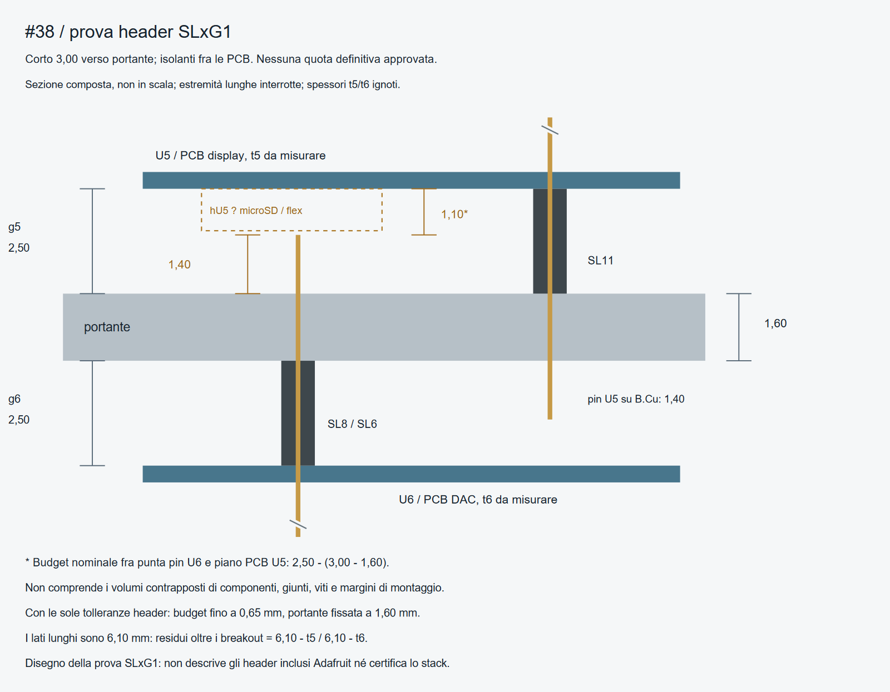

# Issue #38 — ricontrollo degli header SLxG1

Aggiornamento del **31 ottobre 2026**, dopo l'integrazione della
[issue #38](https://github.com/Capobuf/ESP-DubSiren/issues/38).
Il riferimento commerciale dello studio è ora identificato; le strisce
effettivamente incluse da Adafruit restano senza MPN/quote accertati.
Nessuna modifica alla BOM, ai footprint o al placement.

**Esito: 2,50 mm è una separazione nominale da provare, non una compatibilità
dimostrata.** Con lato corto U6 verso la portante, il budget fra punta del pin
e piano della PCB U5 è 1,10 mm. Le altezze locali sul retro del display non
sono documentate nelle fonti consultate: non è ricavabile un'altezza minima
numerica affidabile per l'intero stack.

## Quote documentate e calcoli

Verificati il [disegno SLxG1](https://mm.digikey.com/Volume0/opasdata/d220001/medias/docus/6161/SLxxG1x.pdf)
e le pagine del produttore [SL11G1](https://en.econconnect.de/econ-connect-pin-header-1-x-11-pin-straight-pitch-2-54-mm-sl11g1-1.html),
[SL8G1](https://en.econconnect.de/econ-connect-pin-header-1-x-8-pin-straight-pitch-2-54-mm-sl8g1-1.html)
e [SL6G1](https://en.econconnect.de/econ-connect-pin-header-1-x-6-pin-straight-pitch-2-54-mm-sl6g1-1.html).
SL11 corrisponde alla fila U5, SL8 e SL6 alle due file U6.

| Dato | Valore | Natura |
|---|---:|---|
| Passo / pin quadrato | 2,54 / 0,64 mm | Disegno commerciale |
| Altezza isolante | 2,50 mm | Disegno; tolleranza generale .XX ±0,20 |
| Lati A / B | 6,10 / 3,00 mm | Disegno; tolleranze esplicite ±0,25 |
| Lunghezza complessiva | 11,60 mm | Somma delle tre quote, non distacco PCB–PCB |
| Portante | 1,60 mm | Spessore nominale di progetto, non misura del pezzo |
| Distanza fra superfici PCB | 2,50 mm | Solo se entrambe appoggiano sulle facce opposte dell'isolante |
| Punta U6 sopra F.Cu, lato corto nella portante | 3,00−1,60 = **1,40 mm** | Prima di taglio e saldatura |
| Punta U6 sopra F.Cu, lato lungo nella portante | 6,10−1,60 = **4,50 mm** | Prima di taglio e saldatura |
| Budget U5–punta corta U6 | 2,50−1,40 = **1,10 mm** | Prima dei volumi locali di componenti/giunti |
| Budget U5–punta lunga U6 | 2,50−4,50 = **−2,00 mm** | Orientamento incompatibile con questa separazione senza interventi sui pin |

Con le sole tolleranze dichiarate dell'isolante U5 e del pin corto U6,
mantenendo la portante esattamente a 1,60 mm, il budget peggiore scende a
`(2,50−0,20)−[(3,00+0,25)−1,60] = 0,65 mm`.
Non include tolleranza dello spessore portante, saldature, ferramenta,
inclinazione o componenti U5. Non è una clearance minima garantita.

### Accoppiamento con i fori esistenti

Il disegno raccomanda fori **Ø1,02 mm**; i pad U5/U6 esportati hanno drill
**Ø1,00 mm**. Il pin quadrato nominale ha diagonale circa **0,905 mm**:
esiste margine nominale, ma ciò non qualifica l'accoppiamento alle tolleranze
di pin, foro finito e metallizzazione. Non è stata modificata la foratura;
SLxG1 non è dichiarato automaticamente intercambiabile con il kit Adafruit.

## Verso, corpi plastici e accesso alla saldatura

**U6:** nella prova l'isolante è fra B.Cu della portante e faccia interna del
DAC, con il **lato corto verso la portante** e quello lungo verso il DAC.
Il distacco è 2,50 mm soltanto con appoggio completo delle due PCB.
Il lato lungo emerge sulla faccia componenti del DAC per `6,10−t6`, dove
`t6` è lo spessore reale del breakout, ancora ignoto. Non si attribuisce a
quel tratto la protrusione di 1,40 mm calcolata per la portante.

Montare e saldare prima le strisce al DAC dalla sua faccia componenti,
controllando accesso alla punta e ai pad fra le parti già presenti. Presentare
poi il DAC alla portante, saldando i pin corti dal fronte ancora libero da U5.
I pin hanno 1,40 mm nominali disponibili sulla portante: la qualità del giunto
va verificata; nessun taglio a filo è prescritto. Un eventuale taglio si fa
con accesso e controllo del giunto, prima di montare U5.
Sul retro interno del DAC controllare anche i terminali/giunti del jack
PJ-332A, la cui sporgenza Z non è quotata nei file Eagle consultati.

**U5:** valutato separatamente l'orientamento con lato corto verso la portante,
isolante fra F.Cu e retro della PCB display, lato lungo verso la faccia TFT.
Il pin corto emergerebbe su B.Cu della portante per 1,40 mm, quello lungo
sul breakout per `6,10−t5`, con `t5` ancora ignoto. Nel modello XY la fila
U5 a Y59,835 è esterna al contorno TFT del package Eagle, che termina a
Y56,2: il distacco tra centro fila e contorno è 3,635 mm. Questo consente di
individuare il lato da cui saldare, ma non certifica spazio per utensile,
pin lunghi, saldatura, vetro reale e flex. Non far passare i pin dalla parte
opposta per ottenere automaticamente un presunto distacco maggiore.

La [guida Adafruit](https://learn.adafruit.com/how-to-solder-headers/feathers-and-featherwings)
descrive il montaggio delle strisce; non certifica quote o accessibilità di
questo accoppiamento a tre PCB. Saldare il display alla portante solo dopo
la verifica a secco e l'ispezione del DAC.

## Plastica, ferramenta e volumi sotto U5

Gli inviluppi rettangolari nominali delle strisce, ricostruiti sulle file
effettive con corpo centrato secondo il disegno commerciale, sono:

| Striscia | X min–max | Y min–max, mm |
|---|---|---|
| SL11G1 su U5 | 30,046–57,986 | 58,565–61,105 |
| SL8G1 su U6 | 33,840–54,160 | 37,610–40,150 |
| SL6G1 su U6 | 36,380–51,620 | 52,850–55,390 |

Per U5, la distanza dall'inviluppo alle colonne centrate nei due fori inferiori
è **1,905 mm**: un cilindro Ø4 nello stesso volume fra le PCB interseca
l'inviluppo rettangolare per **0,095 mm nominali**. Le estremità smussate,
la posizione esatta del corpo rispetto ai pin e le tolleranze non sono
completamente quotate: è una **compatibilità da verificare**, non una collisione
fisica già misurata. Le teste poste all'esterno di U5 sono a un'altra quota Z.
Non si confermano quattro colonne Ø4 come kit compatibile.
La fila SL8 lascia invece 0,54 mm nominali fra il suo inviluppo e supporti
Ø4 sui due fori U6 adiacenti: anche questo margine precede le tolleranze.

Rimangono le sovrapposizioni XY già documentate: i terminali U6 1/2/3 sotto
la zona microSD e i fissaggi destri sotto/vicino al connettore EYE SPI.
La [pagina download 5393](https://learn.adafruit.com/adafruit-1-47-round-rectangle-tft-display/downloads)
fornisce schema e fab print, ma non un disegno quotato delle altezze del retro.
I file Eagle locali identificano Q2 come `MICROSD`, X1 come
`EYE_SPI_DISPLAY_FLIP`, senza MPN o quota Z. Non sono stati sostituiti con
socket apparentemente simili per inventare un'altezza.
Le quote prodotto 5,4/6,2 mm restano ingombri complessivi dei breakout,
non separazioni fra PCB o altezze della sola faccia interna.

## Altezza minima e manutenzione

La condizione da verificare localmente è:

`g5 > max sulle zone sovrapposte [hU5(x,y) + hF(x,y)] + margine verificato`

`hF` è il massimo locale di punta pin, giunto e testa vite U6, senza sommare
automaticamente altezze che non si sovrappongono. Per il pin corto non tagliato
si conosce la quota nominale di 1,40 mm; manca la corrispondente sporgenza
U5, quindi **1,40 mm non è l'altezza minima dello stack**. A g5=2,50,
microSD/flex e ogni altro volume contrapposto devono rientrare nel budget
locale residuo, prima delle tolleranze e del margine. Non è ancora dimostrato.

Se la prova esclude 2,50 mm, un tipo commerciale da valutare è un header
PTH con lato lungo adeguato e distanziali commerciali alla quota risultante
dalle misure. La stessa serie documenta la versione F, A=12,3/B=3,0:
**allunga i pin, non l'isolante da 2,50 mm**. Con isolante appoggiato alla
portante e breakout sostenuto a quota D, occorre verificare almeno
`D + t5 + sporgenza necessaria alla saldatura ≤ 2,50 + A`, alle tolleranze.
Non è selezionato un D o un MPN definitivo, né dichiarata la compatibilità
di questa alternativa in assenza delle quote mancanti. Non serve un pezzo custom.

SL11G1 è un maschio passante: se saldato a entrambe le PCB **non rende il
display sfilabile**. Per manutenzione occorre dissaldare i suoi 11 contatti
dal lato accessibile e liberare i fissaggi; la facilità e l'accesso vanno
qualificati. La precedente ipotesi di sfilare U5 da uno zoccolo non descrive
il riferimento SLxG1 e non viene mantenuta come soluzione già disponibile.

I [calcoli e gli inviluppi](placement-38/header-study.json) si riferiscono
allo stesso hash PCB della verifica precedente. I 18 rilievi DRC restano
segnalazioni XY dello stack da valutare; non sono stati esclusi o trasformati
in un'approvazione meccanica. Placement, reti e 160 connessioni non instradate
restano invariati. Nessun acquisto, routing o modifica della BOM è autorizzato
da questa integrazione.
